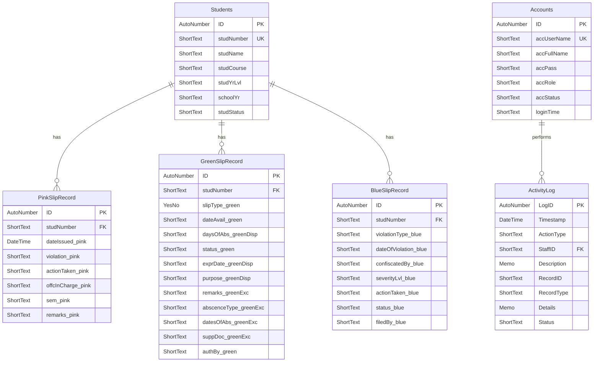

# Student Conduct Management System (SCMS)
 
A Windows desktop application for the **Cor Jesu College (CJC) Office of the Prefect**. SCMS records student conduct events, keeps searchable student histories, enforces escalation and semester rules, and produces operational reports.
 
Built with **Python**, **PyQt5**, and a **Microsoft Access** (`.accdb`) database accessed through `pyodbc`.
 


 
> **Note:** The older `SCMS/README.md` describes an earlier UI-only prototype. This document describes the current database-backed system.
 
---
 
## Table of Contents
 
- [Features](#features)
- [Slip Types at a Glance](#slip-types-at-a-glance)
- [Installation (End Users)](#installation-end-users)
- [Getting Started](#getting-started)
- [Required Software and Dependencies](#required-software-and-dependencies)
- [Running from Source (Developers)](#running-from-source-developers)
- [Architecture](#architecture)
- [Database and File Locations](#database-and-file-locations)
- [Database Schema](#database-schema)
- [Building and Releasing](#building-and-releasing)
- [Testing](#testing)
- [Developer Guidelines](#developer-guidelines)
- [Troubleshooting](#troubleshooting)
- [Known Limitations](#known-limitations)
- [Contributing](#contributing)
---
 
## Features
 
### Authentication and Application Shell
- Login with username/password validated against the `Accounts` table
- Active/inactive account handling and login-time tracking
- Two roles: **Admin** and **Staff**
- Sidebar navigation, status bar with current user/role, CJC branding, logout, and high-DPI support
- Clear startup errors for missing database or configuration problems
### Dashboard
- Welcome banner and current date
- Current and monthly counts for Green, Pink, and Blue Slips
- Quick-navigation cards and a recent activity table
- Automatic Green Slip expiry check on refresh
### Green Slips
- **Dispensation** — student, date availed, number of days, purpose, expiry, status, authorizing officer
- **Excuse** — absence type, absence dates, supporting document, remarks, authorizing officer
- Automatic expiry-date calculation; expired active records are set to `Expired`
- Students not yet in the database are created automatically
- Tracker with search, filtering, details, summary statistics, and charts
### Pink Slips
- Records a penalty/notice with date, violation, action taken, officer, semester, and remarks
- **Business rule:** one Pink Slip per student per semester
- Tracker with semester filter and student lookup, plus statistics and charts
### Blue Slips
- Records violations with type, date, severity level (1–4), description, witnesses, action taken, and status
- Manual escalation, plus **automatic escalation** when a student has two or more previous violations of the same type
- Color-coded tracker, status updates, per-student history, and step-by-step progress view
### Record Trackers and Monthly Analysis
- Combined Green/Pink/Blue view and search by student number
- Filter by period and slip type; monthly tables, counts, and charts
- PDF export for student records and monthly summaries
### Reports and Analytics
- Overview report plus separate Green, Pink, and Blue tabs
- Student conduct summary and top-record views
- College/course distribution using configurable course mappings
- Embedded Matplotlib charts and PDF export (overview, per slip type, individual student, conduct summary)
### Activity Logs
- Audit trail for creation, modification, deletion, searches, exports, prints, reports, and batch operations
- Query by staff member, action type, date range, or record
- Retention helpers (remove logs older than N days) and CSV export
### Settings
- Change your own password
- Account management: add, edit, activate/deactivate, delete (the signed-in account cannot be deleted)
- School year and semester configuration
- Custom course-to-college mappings
- Green Slip threshold, escalation trigger, and notification preferences
---
 
## Slip Types at a Glance
 
| Slip | Color | Severity | Key behavior |
|---|---|---|---|
| Green | Green | Minor | Dispensation/Excuse; auto-expires |
| Pink | Pink | Medium | One per student per semester |
| Blue | Blue | Major | Severity levels 1–4; auto-escalation on repeat violations |
 
---
 
## Installation (End Users)
 
Choose one of the supported options:
 
1. **Installer** — run `SCMS-Setup-vX.Y.Z.exe`.
2. **Portable build** — copy the `dist\SCMS\` folder and run `SCMS.exe`.
3. **PowerShell installer** — run `Install-SCMS.ps1` as administrator. Optional parameters: `-InstallPath` and `-CreateDesktopIcon`.
4. **Custom installer** — compile `SCMS-Installer.iss` with Inno Setup.
### Requirements
- Windows 10/11
- **Microsoft Access Database Engine (ODBC driver)** matching the app's architecture (x86/x64). The code expects the driver named `Microsoft Access Driver (*.mdb, *.accdb)`.
Python is **not** required for packaged builds, but the Access driver still is unless your environment already provides it.
 
---
 
## Getting Started
 
Default accounts are created when the account table is empty:
 
| Username | Password | Role |
|---|---|---|
| `admin` | `admin123` | Administrator |
| `staff` | `staff123` | Office Staff |
 
> **Change these passwords immediately** after first login via **Settings → Change Password**.
 
---
 
## Required Software and Dependencies
 
### System Software
 
| Component | Purpose | Notes |
|---|---|---|
| Windows 10/11 | Operating system | Recommended platform |
| Python 3.12 or 3.13 | Application runtime | Not needed for packaged builds |
| Microsoft Access Database Engine (ODBC driver) | Lets the app read/write the `.accdb` database | Driver name: `Microsoft Access Driver (*.mdb, *.accdb)`. Must match the Python/app architecture (x86 or x64). Database Engine 2016 is recommended |
| Git and PowerShell | Cloning the repo and running build scripts | Developers only |
 
### Python Libraries
 
Install everything with `python -m pip install -r requirements.txt`.
 
| Library | Version | Purpose |
|---|---|---|
| **PyQt5** | `==5.15.9` | Desktop GUI framework (windows, pages, dialogs, widgets) |
| **pyodbc** | `>=5.3.0` | Connects Python to the Access database through ODBC |
| **Matplotlib** | `>=3.5.0` | Charts embedded in the UI and rendered into PDF reports |
| **ReportLab** | `>=4.0.0` | PDF generation for reports and student records |
| **Pillow (PIL)** | `>=10.0.0` | Image handling for logos and banners |
| **qtawesome** | `>=1.0.0` | Icons in the PyQt5 interface |
 
 
### Build Tools (only for creating the installer)
 
| Tool | Purpose |
|---|---|
| PyInstaller | Bundles the app into an executable (`scms.spec`) |
| Inno Setup 6 | Compiles the Windows installer (`SCMS-Installer.iss`) |
 
### Data Storage
 
| Item | Purpose |
|---|---|
| `SCMSDatabase.accdb` (Microsoft Access) | Accounts, students, slips, and activity logs |
| `SCMS/config.json` | School years, semesters, course mappings, thresholds, notification settings |
 
SCMS is a standalone desktop application. It needs no internet connection and no database server.
 
---
 
## Running from Source (Developers)
 
### Prerequisites
- Windows 10/11
- Python 3.12 or 3.13
- Microsoft Access Database Engine / ODBC driver (matching your Python architecture)
- Git and PowerShell
### Setup
 
```powershell
python -m venv .venv
.\.venv\Scripts\Activate.ps1
python -m pip install --upgrade pip
python -m pip install -r requirements.txt
Set-Location .\SCMS
python .\main.py
```
 
If PowerShell blocks script activation, call the interpreter directly:
 
```powershell
.\.venv\Scripts\python.exe -m pip install -r .\requirements.txt
.\.venv\Scripts\python.exe .\SCMS\main.py
```
 
On the first successful database connection, SCMS creates `%APPDATA%\SCMS` and copies the template database there. Make sure your user has write access to that folder.
 
---
 
## Architecture
 
### Runtime Flow
 
1. `SCMS/main.py` configures logging, high-DPI behavior, branding, Matplotlib defaults, database initialization, and student constraints.
2. `ui.login_window.LoginWindow` validates credentials and opens the main window.
3. `ui.main_window.MainWindow` builds the shell and lazy-loads each feature page.
4. UI pages call focused backend modules instead of embedding SQL in the interface.
5. Backend modules use a shared Access connection pool with parameterized queries.
6. On shutdown, the connection pool is closed.
### Key Modules
 
| Area | Files | Responsibility |
|---|---|---|
| Startup | `SCMS/main.py` | Initialization, logging, exception hook |
| Navigation | `SCMS/ui/main_window.py` | Shell, sidebar, page lifecycle, logout |
| Authentication | `SCMS/ui/login_window.py`, `SCMS/backend/db_accounts.py` | Login and account operations |
| Database access | `SCMS/backend/db_connection.py` | Discovery, AppData copy, pooled connections |
| Students | `SCMS/backend/db_students.py` | Creation, lookup, uniqueness, protected deletion |
| Green Slips | `SCMS/backend/db_green_slip.py` | Persistence, date parsing, expiry |
| Pink Slips | `SCMS/backend/db_pink_slip.py` | Persistence and semester checks |
| Blue Slips | `SCMS/backend/db_blue_slip.py` | Violations, escalation, history, status/deletion |
| Configuration | `SCMS/backend/config.py`, `SCMS/config.json` | School years, semesters, courses, thresholds |
| Audit | `SCMS/backend/db_activity_log.py` | Log queries and convenience logging |
| Reports | `SCMS/backend/pdf_export.py`, `SCMS/ui/pdf_preview_dialog.py` | PDF generation and preview |
| Charts | `SCMS/ui/chart_widgets.py` | Embedded Matplotlib charts |
 
---
 
## Database and File Locations
 
| Item | Location |
|---|---|
| Template database (in repo) | `SCMS/backend/database/SCMSDatabase.accdb` |
| **Live database** | `%APPDATA%\SCMS\SCMSDatabase.accdb` |
| Debug logs | `%APPDATA%\SCMS\logs\scms_debug_YYYYMMDD_HHMMSS.log` |
| Configuration | `SCMS/config.json` |
| Build output | `build\`, `dist\`, `SCMS-Setup-vX.Y.Z.exe` |
| Version backups | `.backups\` |
 
The AppData copy is the live, writable database; the repository file is only a template.
 
**Main tables:** `Accounts`, `Students`, `Green Slip Record`, `Pink Slip Record`, `Blue Slip Record`, plus the activity-log table created by `db_init_activity_log.py`.
 
> Always back up `%APPDATA%\SCMS\SCMSDatabase.accdb` before upgrades, migrations, or manual database work.
 
### Opening and Connecting to the Database
 
**You normally don't need to connect manually.** On launch, `SCMS/backend/db_connection.py` verifies that the Access driver is installed, copies the template database to `%APPDATA%\SCMS\` on first use, and opens a pooled `pyodbc` connection to that copy.
 
**1. Check that the Access driver is installed**
 
```powershell
python -c "import pyodbc; print([d for d in pyodbc.drivers() if 'Access' in d])"
```
 
The output should include `Microsoft Access Driver (*.mdb, *.accdb)`. If the list is empty, install the Microsoft Access Database Engine (matching your Python architecture: 32-bit or 64-bit) and restart Windows.
 
**2. Open the database directly (optional, for inspection)**
 
- With Microsoft Access: open `%APPDATA%\SCMS\SCMSDatabase.accdb`. Close the app first, because Access is a single-file database and can lock it.
- With Python (`pyodbc`):
```python
import os
import pyodbc
 
db_path = os.path.expandvars(r"%APPDATA%\SCMS\SCMSDatabase.accdb")
conn = pyodbc.connect(
    r"DRIVER={Microsoft Access Driver (*.mdb, *.accdb)};"
    rf"DBQ={db_path};"
)
cursor = conn.cursor()
cursor.execute("SELECT TOP 5 * FROM Students")
print(cursor.fetchall())
conn.close()
```
 
- With the repo helpers: `python check_db.py` inspects the database, and `python dump_schema.py` writes the schema to `schema.md`.
**3. Start the application**
 
Follow [Running from Source](#running-from-source-developers) (`python .\SCMS\main.py`) or launch the installed `SCMS.exe`, then sign in with a [default account](#getting-started).
 
**4. Start over with a fresh database**
 
Close SCMS, back up `%APPDATA%\SCMS\SCMSDatabase.accdb`, then remove it. SCMS copies the template again on the next launch. Template and default accounts are described in [Database and File Locations](#database-and-file-locations).
 
> Always experiment on a copy of the database, never your live AppData file.
 
---
 
## Database Schema
 
SCMS stores its data in `SCMSDatabase.accdb` (Microsoft Access). `Students` is the central entity: every slip table links to it through the `studNumber` foreign key. `Accounts` handles authentication, and `ActivityLog` records an audit trail of user actions, referencing `Accounts` by username.
 
> The schema below follows the project's Software Requirements Specification (SRS). Access column names are case- and spelling-sensitive (including legacy typos such as `abscenceType_greenExc`), so copy them exactly in queries and wrap them in brackets. To confirm the schema in a given database file, run `python dump_schema.py`.
 
### Entity Relationship Diagram
 

 
### Data Dictionary
 
#### `Accounts`
 
Login credentials and role assignments (Admin, Staff). Used by the authentication module. Independent of the other tables.
 
| Field | Type | Key | Constraints | Description |
|---|---|---|---|---|
| `ID` | AutoNumber | PK | Not null, unique | Auto-generated primary key |
| `accUserName` | Short Text | UK | Not null, unique | Login username (e.g., `admin`, `staff`) |
| `accFullName` | Short Text | | Not null | Full name shown in the sidebar |
| `accPass` | Short Text | | Not null, min 8 chars on update | Account password (stored as plain text, see [Known Limitations](#known-limitations)) |
| `accRole` | Short Text | | `Admin`, `Staff` | Determines which features are available |
| `accStatus` | Short Text | | `Active`, `Inactive` | Whether the account is enabled |
| `loginTime` | Short Text | | Nullable | Timestamp of the most recent successful login |
 
#### `Students`
 
Master list of students and the central reference for all slip records.
 
| Field | Type | Key | Constraints | Description |
|---|---|---|---|---|
| `ID` | AutoNumber | PK | Not null, unique | Auto-generated primary key |
| `studNumber` | Short Text | UK | Not null, unique | School-assigned ID (e.g., `2024-0001`); referenced by all slip tables |
| `studName` | Short Text | | Not null | Full name in Last, First Middle format |
| `studCourse` | Short Text | | Not null | Course or degree program |
| `studYrLvl` | Short Text | | `1st`-`4th`, `5th` | Current year level |
| `schoolYr` | Short Text | | Not null | Academic school year (e.g., `2024-2025`) |
| `studStatus` | Short Text | | `Regular`, `Irregular` | Enrollment classification |
 
> Students are intentionally protected from deletion in the backend.
 
#### `Pink Slip Record`
 
Final-warning slips. **Business rule:** one Pink Slip per student per semester.
 
| Field | Type | Key | Constraints | Description |
|---|---|---|---|---|
| `ID` | AutoNumber | PK | Not null, unique | Auto-generated primary key |
| `studNumber` | Short Text | FK | Not null, references `Students` | Student who received the slip |
| `dateIssued_pink` | Date/Time | | Not null, defaults to today | Date issued |
| `violation_pink` | Short Text | | `Uniform Violation`, `Tardiness`, `Misconduct`, `Prohibited Items`, `Disrespect`, `Others` | Violation type |
| `actionTaken_pink` | Short Text | | `Warning`, `Parent Notification`, `Community Service`, `Suspension`, `Others` | Disciplinary action applied |
| `offcInCharge_pink` | Short Text | | Not null | Officer who filed the slip |
| `sem_pink` | Short Text | | `1st`, `2nd`, `Summer` | Semester; used for the one-per-semester rule |
| `remarks_pink` | Short Text | | Nullable | Additional context |
 
#### `Green Slip Record`
 
Dispensation and Excuse slips in one table. `slipType_green` distinguishes them: fields suffixed `_greenDisp` apply to dispensations, and fields suffixed `_greenExc` apply to excuses.
 
| Field | Type | Key | Constraints | Description |
|---|---|---|---|---|
| `ID` | AutoNumber | PK | Not null, unique | Auto-generated primary key |
| `studNumber` | Short Text | FK | Not null, references `Students` | Student who received the slip |
| `slipType_green` | Yes/No | | Not null | Yes = Dispensation, No = Excuse |
| `dateAvail_green` | Short Text | | Not null, defaults to today | Date availed or filed |
| `daysOfAbs_greenDisp` | Short Text | | Min value 1 | Days covered (dispensation) |
| `status_green` | Short Text | | `Active`, `Expired` | Dispensations auto-expire after the expiry date |
| `exprDate_greenDisp` | Short Text | | Auto-calculated, read-only | `dateAvail_green` + `daysOfAbs_greenDisp` |
| `purpose_greenDisp` | Short Text | | Nullable | Reason for the dispensation |
| `remarks_greenExc` | Short Text | | Nullable | Remarks for the excuse |
| `abscenceType_greenExc` | Short Text | | `Medical/Illness`, `Family Emergency`, `School Event`, `Others` | Absence category (excuse) |
| `datesOfAbs_greenExc` | Short Text | | Nullable | Date(s) of absence covered |
| `suppDoc_greenExc` | Short Text | | `Medical Certificate`, `Parent Letter`, `Official Document`, `None` | Supporting document |
| `authBy_green` | Short Text | | Not null | Officer who authorized the slip |
 
> Dates are stored as text. Store them in ISO `YYYY-MM-DD` format and read them back through the shared Green Slip date parser (see [Database Conventions](#database-conventions)).
 
#### `Blue Slip Record`
 
Serious violations with automatic escalation: repeated offenses of the same type by the same student trigger progressively stricter actions.
 
| Field | Type | Key | Constraints | Description |
|---|---|---|---|---|
| `ID` | AutoNumber | PK | Not null, unique | Auto-generated primary key |
| `studNumber` | Short Text | FK | Not null, references `Students` | Student who committed the violation |
| `violationType_blue` | Short Text | | `Bullying/Harassment`, `Uniform Violation`, `Disrespect`, `Prohibited Items`, `Vandalism`, `Others` | Violation category |
| `dateOfViolation_blue` | Short Text | | Not null, defaults to today | Date of the violation |
| `confiscatedBy_blue` | Short Text | | Not null | Officer who filed or handled the case |
| `severityLvl_blue` | Short Text | | `Level 1-Minor` to `Level 5-Severe` | Severity; escalates on repeat offenses |
| `actionTaken_blue` | Short Text | | `Verbal Warning`, `Written Warning`, `Parent Meeting`, `Suspension`, `Endorsement` | Action taken; escalates per system rules |
| `status_blue` | Short Text | | `Open/Pending`, `Resolved` | Case status |
| `filedBy_blue` | Short Text | | | Shown in the ER diagram |
 
**Escalation ladder** (applied per student per violation type):
 
| Offense | Action |
|---|---|
| 1st | Verbal Warning |
| 2nd | Written Warning |
| 3rd | Parent Meeting + Community Service |
| 4th | Suspension |
| 5th | Endorsement / Probation |
 
#### `ActivityLog`
 
Audit trail of user actions (create, modify, view, export, and administrative actions). Created by `db_init_activity_log.py`.
 
| Field | Type | Key | Constraints | Description |
|---|---|---|---|---|
| `LogID` | AutoNumber | PK | Not null, unique | Auto-generated primary key |
| `Timestamp` | Date/Time | | Not null | When the action occurred |
| `ActionType` | Short Text | | Not null (see below) | Type of action performed |
| `StaffID` | Short Text | FK | Not null, references `Accounts.accUserName` | User who performed the action |
| `Description` | Memo | | Not null | Human-readable summary |
| `RecordID` | Short Text | | Nullable | ID of the affected record (slip number or student ID) |
| `RecordType` | Short Text | | `Green Slip`, `Pink Slip`, `Blue Slip`, `System` | Type of affected record |
| `Details` | Memo | | Nullable | Technical details (before/after values, export format, parameters) |
| `Status` | Short Text | | `SUCCESS`, `FAILED` | Outcome of the action |
 
**Action types:** `SLIP_CREATED`, `SLIP_MODIFIED`, `SLIP_DELETED`, `SLIP_VIEWED`, `FILE_EXPORTED`, `REPORT_GENERATED`, `PRINT_ACTION`, `USER_AUTHENTICATED`, `SETTINGS_CHANGED`, `BATCH_OPERATION`, `RECORD_IMPORTED`, `RECORD_SEARCHED`.
 
### Configuration (`config.json`)
 
System settings that are not stored in Access: school years, current semester, course-to-college mappings, the Green Slip threshold, the Blue Slip escalation trigger, and notification preferences.
 
---
 
## Building and Releasing
 
### Local Build
 
Requires PyInstaller, Inno Setup 6, and PowerShell.
 
```powershell
python -m pip install pyinstaller
.\build-and-package.ps1
```
 
| Option | Purpose |
|---|---|
| `-VersionType patch\|minor\|major` | Choose the version increment |
| `-DryRun` | Preview the build without making changes |
| `-SkipTest` | Skip checks |
| `-SkipInstallerBuild` | Build the executable only |
 
The script validates prerequisites, backs up previous outputs, cleans build directories, updates `VERSION` and `CHANGELOG.md`, runs `scms.spec`, and compiles the Inno Setup installer. Do not hand-edit `build\` or `dist\` — fix the source or packaging configuration instead.
 
### GitHub Actions
 
`.github/workflows/build-release.yml` runs on Windows when a `v*` tag is pushed or when manually dispatched. It installs Python 3.12, dependencies, PyInstaller, and Inno Setup, builds the executable and installer, uploads artifacts, and creates a GitHub release for tags.
 
### Recommended Release Sequence
 
1. Make and test the source change.
2. Review database and packaged-resource implications.
3. Build locally when possible.
4. Use the build script to bump the version.
5. Review the generated changelog and installer.
6. Commit and push.
7. Push the matching `vX.Y.Z` tag to trigger the release workflow.
---
 
## Testing
 
There is no conventional `tests/` package yet. Current verification tools:
 
| File | Purpose |
|---|---|
| `test_green_slip_save.py` | Integration check of student creation and Green Slip write/read-back on a temporary DB copy |
| `check_db.py` | Database inspection helper |
| `automate_test.py`, `automated_run.py` | Legacy UI automation (outdated, see below) |
 
```powershell
python .\test_green_slip_save.py
```
 
**Manual smoke test:** startup, login, dashboard refresh, create each slip type, Pink Slip semester enforcement, Blue Slip escalation, tracker filters, report PDF generation, activity-log export, settings changes, logout, and persistence after restart.
 
---
 
## Developer Guidelines
 
### Before Changing Code
1. Read the relevant UI page and backend module together.
2. Search for existing helpers before adding new SQL, date parsing, chart code, dialogs, or logging.
3. Check impact on the template DB, AppData DB, PyInstaller spec, installer script, config, and reports.
4. Preserve existing field names and parameterized-query patterns.
5. Inspect the worktree first and don't overwrite unrelated changes.
### Implementing Features
- Put persistence and business rules in `SCMS/backend`; keep UI state and validation in `SCMS/ui/pages`.
- Reuse `InfoDialog`, `ConfirmDialog`, existing styles, components, and `DataEvents` patterns.
- Log user-visible operations through `db_activity_log.py`.
- Make writes transactional: commit on success, roll back on failure, close the connection in `finally`.
- For student-linked slips, use the existing student-enrichment helper.
- Use the shared Green Slip date parser for dates returned by Access.
- Add or update a focused verification script for data-affecting changes.
- Update related docs and `CHANGELOG.md` for release changes.
### Database Conventions
- Always use parameterized SQL (`?` placeholders).
- Access/ODBC field names contain spaces and legacy prefixes. **Preserve bracketed identifiers.**
- The pool keeps five reusable connections; always return borrowed connections.
- Test writes against a temporary copy of the database, never a live AppData database.
- Dates should be stored in ISO `YYYY-MM-DD` format. Regional settings (e.g., Philippine locale) can make Access return `DD/MM/YYYY`, so go through the shared parser.
- Green Slip boolean fields should be written as integers (`1`/`0`) for compatibility across ODBC driver versions.
### UI and Page Lifecycle
- Pages are lazy-loaded; avoid expensive imports or DB work at startup.
- Refresh data when a page becomes visible; don't leave timers or connections open after a page closes.
- Keep navigation indices in `main_window.py` in sync with page factories and placeholders.
- Preserve the Navy/Gold theme and the Green/Pink/Blue color language.
- Surface failures through dialogs and logging. Never return empty, success-shaped data after a failed write or query.
- On Python 3.13, use the Matplotlib `Agg` backend and render to a `QPixmap` rather than the `Qt5Agg` backend.
### Security Considerations
- Passwords are currently stored and compared directly in the Access database (see [Known Limitations](#known-limitations)).
- Do not commit live databases, credentials, installers, logs, or secrets.
- Student records are protected from deletion in the backend; prefer status/archive behavior if removal is ever needed.
- Access is a local, file-based database and not a multi-user server. Avoid designs that assume PostgreSQL/SQL Server transaction or concurrency behavior.
---
 
## Troubleshooting
 
| Symptom | Likely cause / fix |
|---|---|
| Login works, then the app fails while loading the dashboard | Missing or mismatched Access ODBC driver. Install the **Microsoft Access Database Engine 2016** with the correct x86/x64 architecture, restart Windows, and retry |
| Startup database/configuration error dialog | Check that `%APPDATA%\SCMS` is writable and that the template database exists |
| Dates look swapped or fail to parse | Regional locale issue; make sure code uses the shared date parser |
| Charts fail to render on Python 3.13 | Use the `Agg` backend (see Developer Guidelines) |
| Unexplained crash or odd behavior | Open the newest file in `%APPDATA%\SCMS\logs\` and reproduce with the smallest affected workflow |
| PowerShell blocks `Activate.ps1` | Use `.\.venv\Scripts\python.exe` directly |
 
---
 
## Known Limitations
 
- **Plain-text passwords.** Any future password-security work needs a migration strategy and an account recovery plan.
- **Access is single-user, file-based.** It is not suited to concurrent multi-user access.
- **Access ODBC driver required.** It is not reliably present on every Windows or Office installation.
- **No automated test suite.** `automate_test.py` and `automated_run.py` reference an older PyQt6/MVC layout (`SCMS.views`, `SCMS.controllers`) and should not be used as-is.
### Documentation Backlog
- `SCMS/README.md` still says "UI Prototype" and needs updating or removal.
- `ALPHA_TESTING.md` has older Python requirements and the typo `SMCSDatabase.accdb` (the correct name is `SCMSDatabase.accdb`).
- `requirements.txt` lists `qtawesome` twice; clean up separately and verify the packaged build.
- Some deployment docs reference a fixed `v1.0.0` installer; use `build-and-package.ps1` and its versioned output as the authority.
---
 
## Contributing
 
1. Fork the repository and create a feature branch.
2. Follow the [Developer Guidelines](#developer-guidelines).
3. Test against a temporary database copy and run `test_green_slip_save.py`.
4. Update `CHANGELOG.md` and any related documentation.
5. Open a pull request describing the change and any database or packaging impact.
---
 
## Quick Reference
 
| Task | Command / File |
|---|---|
| Install dependencies | `python -m pip install -r requirements.txt` |
| Run from source | `python .\SCMS\main.py` |
| Green Slip verification | `python .\test_green_slip_save.py` |
| Inspect database | `python .\check_db.py` |
| Build exe + installer | `.\build-and-package.ps1` |
| Preview a build | `.\build-and-package.ps1 -DryRun` |
| Current version | `VERSION` |
| Entry point | `SCMS\main.py` |
| Release workflow | `.github\workflows\build-release.yml` |
 
---

 
*Developed for the Cor Jesu College Office of the Prefect.*
